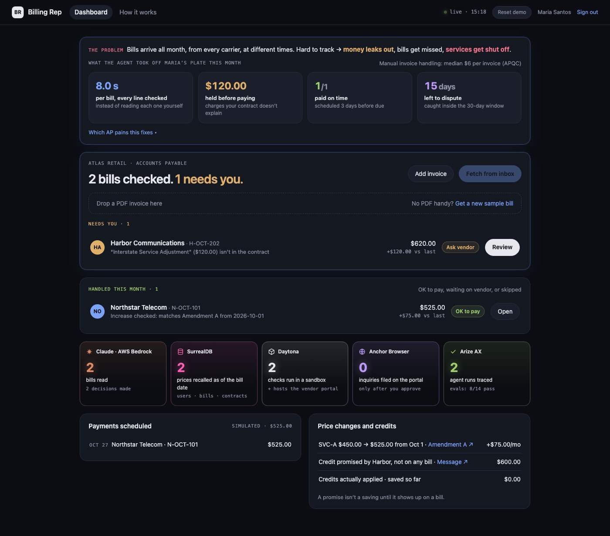
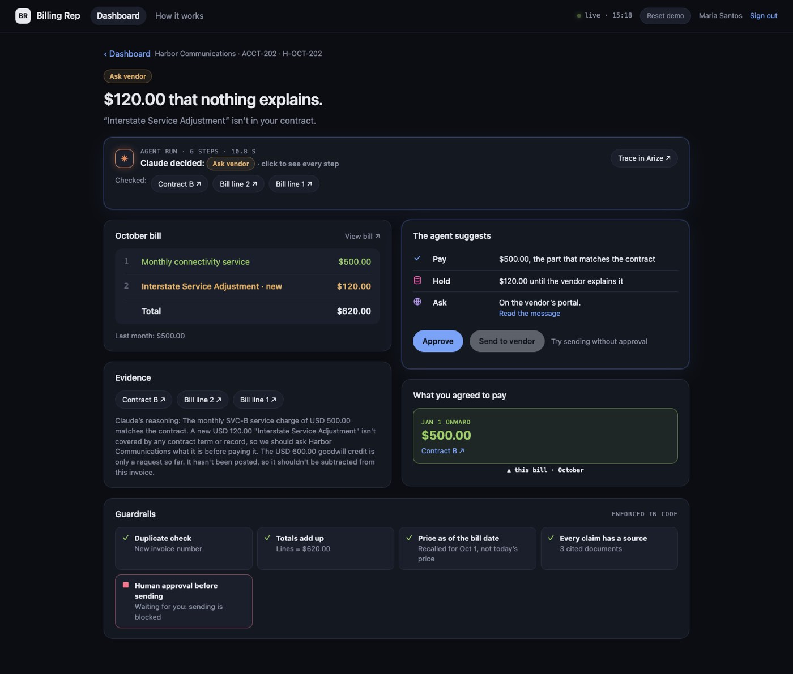
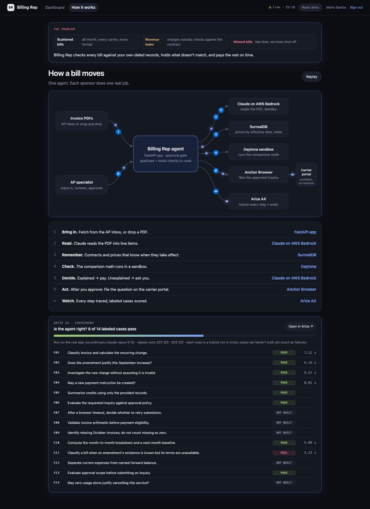
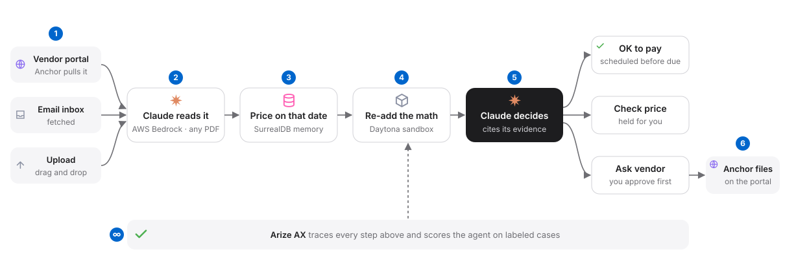

# AI Billing Rep

**An AI billing rep that checks every telecom bill against your own dated contracts, pays what's explained on time, and asks the vendor (after a human approves) about what isn't.**

[](https://www.youtube.com/watch?v=sxglLHsEEKM)

**Live demo:** https://wichita-lanka-hunting-straight.trycloudflare.com · sign in `maria@atlas.example` / `demo-password`
(Runs from our laptop during the event, so it may be offline afterwards. The video above shows the full flow.)



## The problem

Billing teams get bills from many carriers all month long, at different times and in different formats. Nobody checks every charge against the contract, so:

1. **Revenue leaks:** charges that no contract covers get paid anyway.
2. **Bills get missed:** late fees pile up.
3. **Services get shut off:** an unpaid bill turns off a location's lines.

## What it does

Two October bills went up. Which one should the billing team act on?

| Bill | What changed | What the agent does |
| --- | --- | --- |
| **N-OCT-101** (Northstar, from the AP inbox) | $450 → $525 (+$75) | Recalls the price **in effect on Oct 1** from SurrealDB: Amendment A moved SVC-A to $525 from October 1. **Explained**, payment scheduled. The same $525 on a **September** bill is held as *Needs review*, because the amendment wasn't in effect yet. |
| **H-OCT-202** (Harbor, from the carrier portal) | New $120 "Interstate Service Adjustment" | Anchor Browser signs in to Harbor's portal and pulls the PDF. No contract term covers the $120, so it's *Needs clarification* (not "overbilling"). The undisputed $500 is scheduled; the agent drafts an inquiry. Nothing is sent until a person approves; then Anchor files it on the portal and the app stores the portal's case number. |

## Screens

**1. Dashboard.** One page: *Needs you* (bills waiting on a decision) and *Handled* (explained, scheduled, duplicates stopped), the impact so far (money held for review, payments on time, days left to dispute), a live sponsor engine counting what each service did this month, and the money view (payments scheduled, price changes, credits promised vs. actually applied).

**2. Bill page.** The agent run step by step with timings (Claude reads → SurrealDB recalls → Daytona checks → Claude decides), the bill's lines with the unexplained one highlighted, **price over time** (which price was in effect for this bill's period), evidence chips that open the exact cited contract or amendment, the guardrails that applied, and the action card (approve, send, live view of Anchor's browser, portal case).



**3. How it works.** The architecture diagram draws itself in the order a bill moves (press **Replay**), plus the latest Arize eval run: each labeled case, pass or fail.



## Architecture



| # | Step | Who does it |
| --- | --- | --- |
| 1 | **Bring in.** Fetch from the AP inbox (a folder), pull from the carrier portal, or drag and drop a PDF. | FastAPI app + Anchor Browser |
| 2 | **Read.** Claude reads the PDF into line items with a fixed schema (tool call). | Claude on AWS Bedrock (`us.anthropic.claude-opus-5-5`) |
| 3 | **Remember.** Invoices, contracts and prices with the date each took effect; users and sessions too. | SurrealDB |
| 4 | **Check.** The line-by-line comparison runs in a sandbox, not on the laptop. | Daytona |
| 5 | **Decide.** Explained → schedule payment. Unexplained → propose an inquiry and wait for approval. | Claude on AWS Bedrock |
| 6 | **Act.** After approval: file the inquiry on the carrier portal and store the confirmation. | Anchor Browser (portal hosted on Daytona) |
| ∞ | **Watch.** Every step traced; the team's labeled cases scored as experiments. | Arize AX |

### Controls enforced in code (not by the model)

1. **Approval gate:** `POST /api/invoices/{id}/inquiry` returns **403** until an approval for that inquiry exists. The bill page has a "Try sending without approval" link to show it.
2. **No "Submitted" without proof:** an inquiry is marked submitted only after the portal's own API shows the new case. A retry first checks for an existing case and never files twice.
3. **Duplicates:** an invoice number already received is marked *Duplicate* and gets no payment.
4. **Model guard:** if Claude says *Explained* but a line doesn't match the price in effect for its period, the code overrides it to *Needs review*. Citations must point at real evidence ids, or they're dropped.
5. **Totals and dates:** the sandbox checks that lines add up to the total and that dates are valid.
6. **Money states kept apart:** billed, disputed, promised credit and applied credit. The $600 credit the vendor promised counts as saved only once it posts.

## How each sponsor is used

| Sponsor | What it does here | Code |
| --- | --- | --- |
| **Claude on AWS Bedrock** | Reads each PDF into structured lines and makes the decision, both as tool calls with fixed schemas. | `billingrep/llm.py`, `agent.py` |
| **SurrealDB** | Time-aware memory: every price has the date it took effect, and the agent asks "what was the price on this bill's date?". Also users, sessions and sign-in (`crypto::argon2`). | `billingrep/db.py` |
| **Daytona** | Runs the line-by-line comparison in a sandbox and hosts the carrier portal on a preview link. | `billingrep/checks.py`, `portal_deploy.py` |
| **Anchor Browser** | A cloud browser that signs in to the carrier portal, downloads the invoice PDF, and files the approved inquiry. The app streams Anchor's live view while it works. | `billingrep/anchor_actions.py` |
| **Arize AX** | Traces every step (OpenInference) in project `ai-billing-rep`; the 14-case eval pack is logged as dataset `billing-rep-eval-pack` with one experiment per run (latest: 8/14). | `billingrep/tracing.py`, `eval/run_eval.py` |
| **ElevenLabs** | Generates a spoken clarification message. Off by default (`BILLINGREP_VOICE=1` turns it on); never delivered to anyone. | `billingrep/voice.py` |

## Run it

```bash
uv sync
cp .env.example .env        # fill in the keys (AWS Bedrock, Daytona, Anchor, Arize; ElevenLabs optional)
uv run python scripts/build_seed.py      # data/demo_dataset.json -> data/seed.json
uv run python scripts/make_samples.py    # invoice PDFs into data/samples/
uv run python -m billingrep.portal_deploy   # deploys the carrier portal to Daytona, prints its URL
uv run uvicorn billingrep.web:app --port 8010
```

Open http://localhost:8010 and sign in as `maria@atlas.example` / `demo-password` (demo user; the portal's own login is `demo` / `demo`). Step-by-step demo script: [docs/demo-walkthrough.md](docs/demo-walkthrough.md). `HIDE_RESET=1` hides the **Reset demo** button.

## Evaluation (actual results)

The team's 14 labeled cases (`evals/`) run against the **real app** via `eval/run_eval.py` (in-memory database, never the demo's).

1. **Latest run: 8 of 14 pass** (8 of the 9 cases the app implements).
2. **Repeat runs:** E01 (explained increase) and E03 (unexplained surcharge) passed **3 of 3**.
3. **Logged to Arize AX** as one experiment per run, each case a traced run.
4. **Full table** with times and trace ids: [eval/results.md](eval/results.md).

Not built yet, scored as failures on purpose: E07 (browser-timeout retry in the eval adapter; the app itself checks for an existing case before resubmitting), E08 (arithmetic with prior balance), E09 (missing-invoice coverage), E11 (known-but-unavailable amendment), E12 (carried-forward balance), E14 (cancellation).

```bash
uv run python eval/run_eval.py --trials 3
```

## Honest limits

1. **Synthetic data:** all companies, invoices, contracts, portals and amounts are made up. n=1 per case plus 3 repeats of the two demo cases; no accuracy claim beyond that.
2. **Simulated payments:** payment scheduling is a queue; no money moves.
3. **Our own portal:** the carrier portal is ours and runs on Daytona. Real carrier portals need the customer's own logins.
4. **Laptop hosting:** the app runs on a laptop, not in Daytona, because our Daytona tier blocks outbound calls to Anchor Browser.
5. **Cached reads:** PDF reads are cached by file hash so a replay is fast; Claude on Bedrock fills the cache on the first read.
6. **No Gmail yet:** the AP inbox is a folder.
7. **Demo security:** one shared demo login, a fixed portal session, and any signed-in user can reset the demo. Fine for a demo, not for production.

## Repo map

| Path | What |
| --- | --- |
| `billingrep/web.py` | FastAPI routes: sign-in, dashboard data, fetch / portal pull / upload, bill detail, approve, inquiry, stats, eval, docs, portal proxy, reset |
| `billingrep/static/index.html` | The single-page UI: Dashboard, bill page, How it works |
| `billingrep/agent.py` | The pipeline for one bill: read → recall → compare → decide → guard → route |
| `billingrep/llm.py` | Claude on Bedrock: PDF extraction and the decision, both as tool calls |
| `billingrep/db.py` | SurrealDB: seed/reset, prices as of a date, argon2 sign-in, sessions |
| `billingrep/checks.py` | The comparison script, run in a Daytona sandbox |
| `billingrep/actions.py` | Approval gate, inquiry filing, money summary |
| `billingrep/anchor_actions.py` | Anchor Browser: pull the invoice PDF, file the inquiry |
| `billingrep/portal_deploy.py`, `portal/` | The carrier portal and its Daytona deploy |
| `billingrep/docs_render.py` | Renders cited contracts and amendments with the quoted passage highlighted |
| `billingrep/tracing.py`, `voice.py` | Arize AX tracing; ElevenLabs voice (off by default) |
| `data/demo_dataset.json` | The team's ground-truth dataset (cents); `data/seed.json` is generated from it |
| `evals/`, `eval/` | The 14-case pack and scorer; the adapter that runs it against the app |
| `docs/` | Architecture diagram, demo walkthrough, screenshots |
